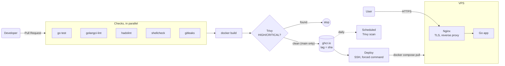

**English** | [Русский](README.ru.md)

# go-service-platform

[](https://github.com/nemelix/go-service-platform/actions/workflows/ci.yml)

A small Go service I use to practice DevOps: containers, CI/CD, deploying to my own server and HTTPS.

Live: https://64-188-81-197.sslip.io/health

## Architecture



## Stack and why

- **Go** - builds into a single binary with no dependencies, so the image is ~19 MB. Docker, Kubernetes and Terraform are written in Go, and I wanted to get to know the language.
- **Docker + Compose** - the standard, and Compose is enough for one server. Kubernetes would be overkill for now.
- **distroless** - a base image with no shell and no package manager. scratch is too empty (no CA certificates, no users), alpine has extra stuff I don't need.
- **GitHub Actions + ghcr.io** - the code is already on GitHub, CI and registry live in one place, and it's free for public repos. Dependabot keeps actions and base images up to date.
- **Nginx + certbot** - Caddy or Traefik would get a certificate on their own, but I wanted to understand ACME and TLS by doing it by hand.
- **sslip.io** - DNS based on the IP address, lets me get a real Let's Encrypt certificate without buying a domain.

Server: VPS with Ubuntu 24.04, 2 vCPU / 4 GB.

## CI/CD

| Event | What happens |
|---|---|
| Pull Request | checks in parallel → image build → Trivy |
| Merge to `main` | the same + push image to ghcr.io → deploy to the server → smoke test |
| Every day (06:30 UTC) | Trivy scans the published image against a fresh vulnerability database |

Checks on every PR:

| Check | What it looks for |
|---|---|
| `go test` | broken logic |
| golangci-lint | mistakes in Go code, including unchecked errors (`errcheck`) and everything `go vet` finds |
| hadolint | bad practices in the Dockerfile |
| ShellCheck | bugs in shell scripts |
| gitleaks | secrets (tokens, keys) in the whole git history |
| Trivy | HIGH/CRITICAL vulnerabilities in the built image that already have a fix |

- Every image is tagged with the commit sha - the tag tells exactly what code is running, and I can roll back to any version.
- Deploy: CI connects over SSH and passes the sha, a script on the server saves the tag to `.env` and updates only the app container.
- After the deploy CI checks `/health` over HTTPS.
- `main` is protected: changes get in only through a PR where every check passed. Each check is added to the ruleset on its own.

## Security

- **Image:** distroless with no shell and no package manager, runs as non-root.
- **Deploy:** a separate `deploy` user with no password and no sudo. Its SSH key is limited with `restrict` and a forced command - the only thing it can do is run the deploy script.
- **Deploy script:** owned by root, accepts only a 40-character commit sha.
- **CI:** the server's host key is checked via `known_hosts` (no `StrictHostKeyChecking=no`), secrets live in the `production` environment, the token has minimal permissions.
- **Network:** only Nginx is exposed (80/443), the app is reachable only inside the Docker network.
- **TLS:** TLS 1.2/1.3 only, HTTP to HTTPS redirect, automatic certificate renewal.
- **Vulnerabilities:** Trivy keeps images with fixable HIGH/CRITICAL vulnerabilities out of the registry. Unfixed ones (`ignore-unfixed`) don't block the build: there's nothing to do about them yet, and a CI that is always red stops being read. The published image is also scanned every day.
- **Secrets:** gitleaks scans the whole git history on every PR, and GitHub push protection is on - a push containing a token is rejected before it reaches the repository.
- **Supply chain:** third-party actions are pinned to a commit sha, not a tag: a tag can be moved to other code, a commit can't. GitHub's own actions (`actions/*`) stay on tags: CI trusts GitHub anyway. Dependabot sends sha updates.

## Problems I ran into

- **The server was running an old version even though the deploy went fine.** The server and the registry had different images under the same `latest` tag. I switched to tagging by commit sha - now it's obvious what's running, and rollback is easy.
- **A container port was reachable from the internet although ufw blocked it.** Docker publishes ports via DNAT, that traffic goes through the FORWARD chain and never hits ufw rules in INPUT. Now only Nginx is published.
- **SSH password login was on, although `sshd_config` said `no`.** `sshd_config.d/50-cloud-init.conf` is included earlier, and sshd uses the first value it finds. Now I check the effective settings with `sshd -T`.
- **The container crashed with `exec /server: no such file or directory`, while the file was there.** The binary was built dynamically (without `CGO_ENABLED=0`), and distroless has no libc or dynamic loader. Found it with `ldd` on the build stage.
- **The linter found a real bug.** errcheck pointed at the unchecked error from `http.ListenAndServe`: if the port was busy, the app quietly exited with code 0. Now the error is logged and the exit code is 1.
- **A PR could be merged although the linter failed.** A failed `lint` made `build` skipped, and GitHub treats a skipped required check as passed. I made every job a required check.
- **Trivy stopped the image from being published.** A HIGH vulnerability in `crypto/x509` from the Go standard library: I don't call x509 myself, but it's compiled in through `net/http`. Bumped Go to the patch release with the fix.

Details and more stories: [docs/problems.md](docs/problems.md).

## Repository layout

```
.
├── main.go                      # the app
├── main_test.go                 # tests
├── Dockerfile                   # multi-stage build
├── docs/
│   ├── problems.md              # problems I ran into, in detail
│   └── problems.ru.md           # the same in Russian
├── .github/
│   ├── workflows/
│   │   ├── ci.yml               # CI/CD: checks → build + Trivy → deploy
│   │   └── scheduled-scan.yml   # daily image scan
│   └── dependabot.yml           # dependency updates
└── deploy/
    ├── docker-compose.yml       # app + Nginx + certbot
    ├── nginx/default.conf       # reverse proxy, TLS
    └── deploy.sh                # deploy script on the server
```

## Run locally

```bash
# without Docker
go run .
curl localhost:8080/health

# in Docker
docker build -t go-service-platform:dev .
docker run --rm -p 8080:8080 go-service-platform:dev
```

## Plans

- [ ] Terraform and Ansible - server setup as code
- [ ] Kubernetes (k3d), Helm, ArgoCD
- [ ] Monitoring: Prometheus / VictoriaMetrics