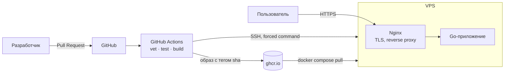

[English](README.md) | **Русский**

# go-service-platform

[](https://github.com/nemelix/go-service-platform/actions/workflows/ci.yml)

Небольшой сервис на Go, на котором я отрабатываю DevOps-практики: контейнеризацию, CI/CD, деплой на свой сервер и HTTPS.

Работает здесь: https://64-188-81-197.sslip.io/health

## Архитектура



## Стек и почему

- **Go** - собирается в один бинарник без зависимостей, образ получается ~19 МБ. На Go написаны Docker, Kubernetes и Terraform, хотелось познакомиться с языком.
- **Docker + Compose** - стандарт, а для одного сервера Compose хватает. Kubernetes на данный момент избыточен.
- **distroless** - базовый образ без shell и пакетного менеджера. scratch слишком пустой (нет CA-сертификатов и пользователей), в alpine есть лишнее.
- **GitHub Actions + ghcr.io** - код уже на GitHub, CI и registry в одном месте, для публичного репозитория бесплатно. Версии actions и базовых образов обновляет Dependabot.
- **Nginx + certbot** - Caddy или Traefik выпустили бы сертификат сами, но я хотел руками разобраться, как работают ACME и TLS.
- **sslip.io** - DNS по IP-адресу, позволяет получить настоящий сертификат Let's Encrypt без покупки домена.

Сервер: VPS на Ubuntu 24.04, 2 vCPU / 4 ГБ.

## CI/CD

| Событие | Что происходит |
|---|---|
| Pull Request | `go vet` → тесты → сборка образа (проверка, что Dockerfile рабочий) |
| Merge в `main` | то же + публикация образа в ghcr.io → деплой на сервер → smoke test |

- Каждый образ помечен sha коммита - по тегу понятно, какой код запущен, и можно откатиться на любую версию.
- Деплой: CI подключается по SSH и передает sha, на сервере скрипт сохраняет тег в `.env` и обновляет только контейнер приложения.
- После деплоя CI проверяет `/health` по HTTPS.
- `main` защищена: попасть в нее можно только через PR с зелеными проверками.

## Безопасность

- **Образ:** distroless без shell и пакетного менеджера, запуск не от root.
- **Деплой:** отдельный пользователь `deploy` без пароля и sudo. Его SSH-ключ ограничен через `restrict` и forced command - с ним можно только запустить скрипт деплоя.
- **Скрипт деплоя:** принадлежит root, принимает только 40-символьный sha коммита.
- **CI:** ключ сервера проверяется через `known_hosts` (без `StrictHostKeyChecking=no`), секреты лежат в environment `production`, у токена минимальные права.
- **Сеть:** наружу открыт только Nginx (80/443), приложение доступно лишь внутри сети Docker.
- **TLS:** только TLS 1.2/1.3, редирект с HTTP на HTTPS, автопродление сертификата.

## С чем столкнулся

- **На сервере работала старая версия, хотя деплой прошел.** На сервере и в registry лежали разные образы с одним тегом `latest`. Перешел на теги по sha коммита - сразу видно, что запущено, и можно откатиться.
- **Порт контейнера был доступен из интернета, хотя в ufw он закрыт.** Docker пробрасывает порты через DNAT, такой трафик идет по цепочке FORWARD и до правил ufw в INPUT не доходит. Теперь наружу публикуется только Nginx.
- **Вход по паролю в SSH был включен, хотя в `sshd_config` стоял `no`.** Файл `sshd_config.d/50-cloud-init.conf` подключается раньше, а в sshd побеждает первое найденное значение. Теперь проверяю итоговые настройки через `sshd -T`.
- **Контейнер падал с `exec /server: no such file or directory`, хотя файл на месте.** Бинарник собрался динамическим (без `CGO_ENABLED=0`), а в distroless нет libc и загрузчика. Нашел через `ldd` на этапе сборки.
- **Старые образы не удалялись после деплоя.** `docker image prune` трогает только образы без тега, а у моих есть тег sha. Чищу по label из Dockerfile.
- **Не хотел давать GitHub полный доступ к серверу.** Отсюда отдельный пользователь для деплоя и ключ, которым можно запустить только один скрипт.

## Структура репозитория

```
.
├── main.go                      # приложение
├── main_test.go                 # тесты
├── Dockerfile                   # multi-stage сборка
├── .github/
│   ├── workflows/ci.yml         # CI/CD: test → build → deploy
│   └── dependabot.yml           # автообновление зависимостей
└── deploy/
    ├── docker-compose.yml       # app + Nginx + certbot
    ├── nginx/default.conf       # reverse proxy, TLS
    └── deploy.sh                # скрипт деплоя на сервере
```

## Запуск локально

```bash
# без Docker
go run .
curl localhost:8080/health

# в Docker
docker build -t go-service-platform:dev .
docker run --rm -p 8080:8080 go-service-platform:dev
```

## Планы

- [ ] Terraform и Ansible - настройка сервера кодом
- [ ] Kubernetes (k3d), Helm, ArgoCD
- [ ] Мониторинг: Prometheus / VictoriaMetrics
